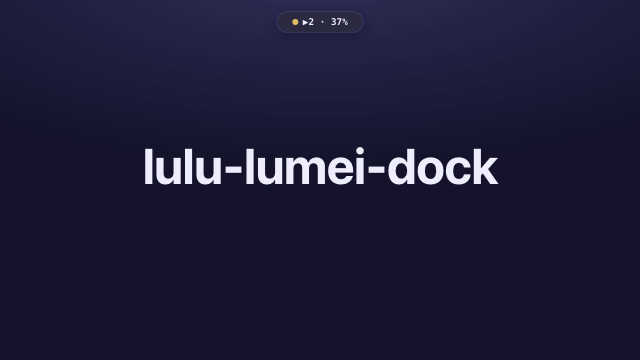
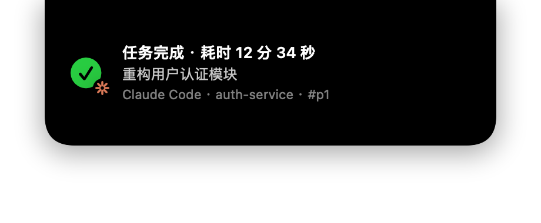
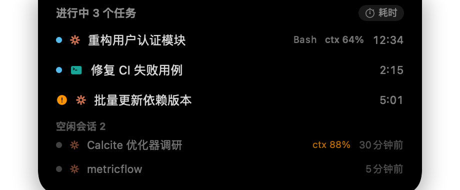

# lulu-lumei-dock ✦

[English](README.md) · **中文**

**把本地 AI 编码助手装进 macOS 菜单栏的一座「灵动岛」。**

把任务活动实时呈现,配上 ccusage 级精度的用量账本、订阅限额余量,以及会话 / 技能 / agent / 记忆管理、
操作审计与云端备份 —— 覆盖 **Claude Code · Codex CLI · opencode · Grok · Antigravity · Kimi Code · Gemini CLI · Qwen Code · Hermes Agent · CodeBuddy · WorkBuddy · Qoder · Cursor · Trae**,全在一处。

`Swift 5.10 + SwiftPM` · `唯一第三方依赖为 Sparkle` · `核心数据留在本地` · 用 Command Line Tools 即可构建(无需完整 Xcode)

> **关于名字** —— 本项目(此仓库)叫 **lulu-lumei-dock**,构建于内部 **Eureka** 代码库之上,因此 Swift
> 模块名(`EurekaKit` 等)、bundle id(`com.vinlee.eureka`)与磁盘数据目录
> (`~/Library/Application Support/Eureka/`)保留 `Eureka` 名以兼容。改动这些会破坏 relay 稳定路径并让现有
> 安装 / 数据库失联,故有意保持原样。

<p align="center">
  
</p>

|  |  |
|---|---|
|  |  |
| **运行中** —— 来源徽标(✳ Claude / ⌨ Codex)+ 计数 + 计时 | **完成卡** —— 耗时 / 会话 / 项目 / 来源 |
|  |  |
| **任务列表** —— 当前工具 / 上下文占用 / 空闲会话 | **健康提示** —— 熬夜编码时的温柔提醒 |

## 语言

界面**默认是英文**。在**设置 → 通用 → 语言**里可以改成简体中文，立即生效，菜单栏和灵动岛一起换。
选择保存在这台 Mac 上，不会离开本机。

## 安装

**Homebrew(推荐)**

```bash
brew tap vinlee19/tap
brew install --cask lulu-lumei-dock
```

**手动下载** —— 从 [Releases](https://github.com/vinlee19/lulu-lumei-dock/releases) 下载最新 `.zip`,解压把 `lulu-lumei-dock.app` 拖进「应用程序」。

从 `v0.1.5` 起可在「设置 → 关于」中检查带签名的应用更新。`v0.1.4` 及更早版本需要最后一次通过
Homebrew 或 Release 手动升级，之后才具备应用内更新能力。

**首次打开:** 本应用为 **ad-hoc 签名**(未做 Apple 公证),可能被 Gatekeeper 拦截。任选其一:右键点按 App →「打开」→ 再次「打开」;或在终端执行:

```bash
xattr -dr com.apple.quarantine /Applications/lulu-lumei-dock.app
```

> 安装后的包名为 `lulu-lumei-dock.app`,数据在 `~/Library/Application Support/Eureka/`(内部名保留 `Eureka` 以兼容,见上方「关于名字」)。从源码构建见 [开发](#开发)。

## 这是什么

`lulu-lumei-dock` 是一个原生 macOS 菜单栏应用:它监视本地 AI 编码助手的日志,把任务活动实时装进刘海
旁的一座「灵动岛」,并提供一个完整面板——用量分析、订阅限额,以及会话 / 技能 / agent / 记忆的管理。

开箱支持十五种助手——**Claude Code、Codex CLI、opencode、Grok、Antigravity、Kimi Code、Gemini CLI、
Qwen Code、Hermes Agent、CodeBuddy、WorkBuddy、Qoder、Cursor、Trae、ZCode**,核心功能**零网络**:
一切都靠读取本地 transcript / rollout / session / 数据库文件推导。联网的只有这些:Claude 订阅限额(非官方
接口,默认关闭,可在设置里 opt‑in);每天拉一次公开的模型价目表(可在「设置 → 高级」关闭);打开或刷新限额页时
运行 `agy` / `opencode` 自己查 Antigravity 与 OpenCode Go 的额度;以及更新器默认访问本仓库的 GitHub Releases
feed 检查新版(可在「设置 → 关于」关闭)。

而且**不装 hooks 也能用**——transcript/rollout 常驻监视兜底,装 hooks 之前开的老会话同样可见。

## 功能总览

**灵动岛通知**
- 有打开的会话时顶部常驻小胶囊(与刘海融合,也可拖到任意位置,松手自动吸附回中央):有会话在运行的来源图标点亮,只剩空闲会话的来源图标变暗;没有打开的会话、也没有未读完成时才隐藏。
- 所有卡片都会自动收回胶囊(悬停暂停):完成 / 出错 / 中断按设置的秒数(默认 6s,设置页 3–15s 可调),
  等待权限 / 输入的橙卡再多 4s(默认 10s)——够看清,又不会一直占着屏幕。橙卡收起不丢信息:
  胶囊保持橙色警示、任务列表里仍标着在等什么、系统通知也留在通知中心。
- 提示音(默认开):完成 / 出错 / 中断 / 等待权限 / 等待输入 / 岛上提问各响一种 macOS 提示音,设置页按类型
  选择和试听(放进 `~/Library/Sounds` 的声音也能选)。卡片不弹就不响;1.5 秒内的多个事件只响一声,更紧急的会打断前一声。
- 多任务合并计数、完成卡排队逐显,点胶囊展开任务列表(当前工具、上下文占用 `ctx%`、空闲会话)。
- 时间显示可切换:已持续时长 ↔ 会话最初开始时间(跨 resume 链取真实创建时刻)。
- 全岛统一的来源徽标(Claude 八芒星 / Codex 风车 / Grok 斜杠方 / opencode 终端 / Antigravity 人字)。

**菜单栏** —— 例如 `▶2 · 37%`:活跃任务数 + 订阅限额取最大值(Codex 5h / Grok 周 / Claude / Antigravity),
60% 橙、85% 红,悬停看明细。

**会话** —— 所有助手的历史与进行中会话集中在一处:按标题 / 项目 / id 搜索,按助手与时间范围筛选,按活跃 /
占用 / 耗时 / 项目排序;打开任一会话可读提问、回复、思考与逐轮工具轨迹,并看费用与上下文占用。既没有提问也没有
回复的空会话(打开就关掉的)不再列出;只有提问(被打断)或只有回复(子代理)的会话照常显示。Codex 会把关闭的
会话压缩成 `.jsonl.zst`,应用内直接解码(无需安装 zstd)。Antigravity 的 `agy` CLI 与 IDE 会话都会列出,
标题取 Antigravity 自己的标题。

**用量账本**(与 `ccusage` 对拍偏差 0.00%)—— 今日 / 本周 / 本月 / 自定义区间,按来源、模型、项目
(归组到仓库根)、会话拆分;估算费用(缓存分价);日 / 小时趋势图;周×小时活跃热力图;以及一个
**技能 / 插件** 页,统计 `skill` / `mcp` / `agent` / `command` / `tool` 的调用次数。近 30 天可导出 CSV。

**Skills(技能)** —— 跨所有有技能的工具浏览、新建、编辑、启用 / 停用技能(启停非破坏:把技能目录移到同级
`*.eureka-disabled`)。并新增专用的**使用分析**视图(列表 ↔ 统计分段):
- 三档排行:**最近使用 / 最常使用 / 最久未使用**,各带最近活跃时间与累计次数。
- 每个列表行显示**最近活跃**时间。
- 每个技能的**详情页**:描述、跨工具**配置矩阵**(Claude/Codex/Grok/Antigravity/opencode 里哪些装了、
  各自是自建还是工具内置,以品牌 logo 展示)、以及调用统计——**次数、触发时 token、按天趋势**。
- 数据说明:逐技能调用数据只有 **Claude** 可得(它的 transcript 把 `Skill` 调用与用量记在同一条)。
  触发时 token ≈ 调用当轮的上下文规模,而非技能整段执行开销——UI 已明确标注。

**Memory(记忆)** —— 跨工具浏览、编辑 `CLAUDE.md` / `AGENTS.md` 与项目级 / 用户级记忆文件,应用内
markdown 预览 + 编辑(原子写入,写前留时间戳备份)。

**Agent** —— 跨工具管理 agent / 子代理定义,与技能一套工作流。

**Plans** —— 浏览与管理 agent 的计划文档。

**限额** —— 订阅额度余量:
- **Codex** 与 **Grok** 读本地快照(Codex 取最新 rollout 的 `rate_limits`;Grok 取
  `~/.grok/logs/unified.jsonl` 的账单行)——**零网络**,无数据即隐藏。
- **Claude** 为 opt‑in(默认关),走非官方接口,任何失败即整块隐藏。首次启用会弹一次钥匙串授权
  (选「始终允许」)。

**审计** —— agent 工具调用的追加式流水(完整命令 / 文件路径,不含输出正文),带三级风险标记。规则看的是解析后的命令而不是原始文本:读取私钥、`.env`、云凭据或 agent 凭据、钥匙串、环境变量为**严重**;删除项目之外的路径、执行下载的脚本、命令里写着明文凭据、破坏性 SQL、改开机自启项或 agent 自身配置为**高危**(这两级会弹岛卡,开启后还会发系统通知,正文里的凭据会先打码);推送到主干、合并、集群与云资源变更、上传文件、发消息类 MCP 工具为**提醒**。
覆盖 Claude Code 与 Codex(hook/notify 通道)、Trae(hook 通道),以及 CodeBuddy、WorkBuddy、Qoder(transcript 扫描)与 Cursor(SQLite 扫描)。

**备份** —— 可选:把本地数据备份到 S3 兼容的云存储(SigV4 签名)。

**签名应用内更新** —— 正式安装的 App 默认每次启动检查一次；发现新版后由你确认下载 / 安装。
自动下载与无人值守安装始终关闭。

**健康关怀** —— 数据健康仪表盘展示每个数据源的心跳 / 产出 / 失败状态(轮询停摆直接红灯);外加连续
活跃过久、并发会话过多、深夜还在跑任务时的温柔提示卡。

## 支持的助手

| 助手 | 实时任务 | 用量/token | 限额 | 会话 | 技能/记忆/Agent |
|---|---|---|---|---|---|
| **Claude Code** | ✅ | ✅ | ✅(opt‑in) | ✅ | ✅ |
| **Codex CLI** | ✅ | ✅ | ✅(本地) | ✅ | ✅ |
| **opencode** | ✅ | ✅ | ✅(OpenCode Go) | ✅ | ✅ |
| **Grok** | ✅ | ✅(自报费用)¹ | ✅(本地) | ✅ | ✅ |
| **Antigravity** | ✅ | ✅(实验)¹ | ✅(经 `agy`) | ✅¹ | ✅ |
| **Kimi Code** | ✅ | ✅ | — | ✅ | ✅(技能) |
| **Gemini CLI** | ✅ | ✅ | — | ✅ | ✅(技能/记忆) |
| **Qwen Code** | ✅ | ✅ | — | ✅ | ✅(技能/记忆) |
| **Hermes Agent** | ✅ | ✅ | — | ✅ | ✅(技能/记忆/计划) |
| **CodeBuddy** | ✅ | ✅ | — | ✅ | ✅(记忆) |
| **WorkBuddy** | ✅⁶ | ✅⁶ | ✅(本地,仅免费模型)⁶ | ✅⁶ | ✅(技能/记忆/规则/Agent/计划)⁶ |
| **Qoder** | ✅ | —² | — | ✅ | ✅(记忆/计划) |
| **Cursor** | ✅³ | ✅(不计费)³ | — | ✅ | ✅ |
| **Trae** | 仅 hooks⁴ | —⁴ | — | ✅(来自记忆库)⁴ | ✅(技能/记忆/规则/计划) |
| **ZCode** | ✅⁵ | ✅⁵ | — | ✅⁵ | ✅(技能)⁵ |

¹ Grok(1.0.4x+)在 `updates.jsonl` 的 `turn_completed` 里记录每轮分模型用量和自报费用(`costUsdTicks`),
费用直接采用,因为 Grok 的 `*-build` 模型不在公开价目表里。Antigravity 的会话库是未公开的 protobuf,
用量靠限额页里的实验开关(默认关)从 `agy` 会话库的 `gen_metadata` 表解出;可读正文来自别处:`agy` 为每个会话写
`brain/<id>/.system_generated/logs/transcript_full.jsonl`(提问、回复、工具调用、错误),`agy` 与 Antigravity IDE
各有一个 `conversation_summaries.db`,存全部会话的标题和正文搜索索引。IDE 会话(`~/.gemini/antigravity/conversations/*.pb`)
是加密的、也没有 transcript,所以只显示提问与回复(没有工具轨迹和时间),也没有用量。`~/.gemini/antigravity-ide` 与
`~/.gemini/antigravity-backup` 是 IDE 目录的旧副本,不读取。Antigravity 的周 / 5 小时额度不落盘,限额卡片靠运行
`agy` 的 `/usage` 取得。Kimi Code 无本地限额快照、无全局记忆 / 磁盘 agent 定义约定,对应列跳过。

² Qoder(CN)本地日志中 token 恒为 0,不展示用量账;会话、实时任务、计划与记忆均正常。
CodeBuddy 的 token 记在 transcript 的 `function_call` 行上,由用量扫描器读取。CodeBuddy 一行指独立的
CodeBuddy Code CLI(`~/.codebuddy/projects`);WorkBuddy 用同一个引擎、以 `~/.workbuddy` 为 home,所以它的
对话都记在 WorkBuddy 名下。只用 WorkBuddy 的机器上没有 CodeBuddy 的用量和会话(`~/.codebuddy/logs` 里的
内存监控日志来自 WorkBuddy 内嵌的引擎)。

³ Cursor 是 IDE 而非 CLI:没有 hook,也没有 transcript 文件。会话、消息、工具调用、ctx% 与 token
全在一个 SQLite 库里(`~/Library/Application Support/Cursor/User/globalStorage/state.vscdb`),
只读打开、2 秒一轮轮询出实时卡片;工作目录经 `workspaceStorage/<id>/workspace.json` 反查,
所属 workspace 已不存在的老会话则不带目录。Cursor 每轮只记 `{inputTokens, outputTokens}`、
**没有缓存拆分**,且 `inputTokens` 是整个重发的上下文,故按相邻差分归集(与 Codex 扫描器同一套路),
一个会话的新鲜输入之和才等于最终上下文而不是约 5 倍。Cursor 按请求订阅计费、多数轮次只报
`default` 模型,因此价格表里 `cursor/` 前缀一律标 `unknown`:**只统计 token,金额恒为 0**。
本地无限额快照(配额只在官网与 IDE 内可见)。

Cursor 的知识面位置和别家都不一样,单独写清(约定取自 Cursor 自带的 `create-skill` /
`create-rule` / `create-subagent` 内置技能):
- **技能** —— `~/.cursor/skills/<名>/SKILL.md` 与 `<repo>/.cursor/skills/…`,布局同 Claude;
  `~/.cursor/skills-cursor/` 是官方内置集,只读索引(它自己的 create-skill 明写不许往里写)。
- **记忆** —— 没有全局记忆文件,服务端「Memories」只在本地留个开关;本地等价物是项目规则
  `<repo>/.cursor/rules/*.mdc`,按项目级记忆收录。
- **子代理** —— `~/.cursor/agents/*.md` 与 `<repo>/.cursor/agents/*.md`,YAML frontmatter +
  正文即系统提示,与 Claude 同构。
- **计划** —— 没有 `plans/` 目录,计划是会话里的 `todos` 数组(`todo_write` 工具写),
  按 codex 的 `update_plan` 同一套路合成 markdown 清单。
全文搜索与会话删除同 opencode/Hermes 一样跳过——所有会话共用一个库文件。
该库里同时存着 `cursorAuth/*` token,**绝不纳入备份**,Cursor 只备份 `~/.cursor/skills`。

⁴ Trae 也是 IDE,而且是**两个各自独立的应用**,本 app 把它们并成同一个来源:
Trae CN(`~/.trae-cn` + `~/Library/Application Support/Trae CN`)与国际版
(`~/.trae` + `.../Trae`)。两者并不对称——**只有 CN 版有 hooks 和记忆库**。

它的会话库(`ModularData/ai-agent/database.db`)是 **SQLCipher 加密**的(文件头 16 字节是随机
salt,`sqlite3` 直接拒绝),而且全机没有任何明文转录。所以**没有消息正文、没有 token 账、
没有成本、没有限额**——那几列是空的,不是还没做。启用前有两件事值得先知道:

- **实时卡片依赖 hooks,而 hooks 是按账号灰度的。** Trae CN 实现了一套 Claude Code 兼容的
  hook 运行时(stdin 载荷同为 `hook_event_name` / `session_id` / `cwd` / `tool_input`,输出
  契约同为 `hookSpecificOutput` / `permissionDecision`),所以在 设置 → 集成 里可以把
  `eureka-relay trae-hook` 装进 `~/.trae-cn/hooks.json`——opt‑in、只动带自有标记的条目、
  写前照例备份。**但 hooks 能不能跑是服务端开关**(`dynamicConfig.iCubeApp.hooks.enable`,
  或 ByteDance scope 账号):没放开时 Trae 连配置文件都不会去读,装了也是空转。判断方法:
  Trae 自己的设置里能看到 **Hooks** 页就是已放开,看不到就说明装了没用。hooks 不生效时
  Trae 仍会出现在知识面与会话浏览里,但**永远不上灵动岛**——它是唯一没有转录兜底的来源。
  Trae 也没有权限请求类 hook 事件,所以「等待授权」对它永远不可见。
- **会话来自记忆库。** `memory/projects/<encoded>/<YYYYMMDD>/topics.md` 里每个会话有一段带
  session id 与时间的叙述式摘要,会话列表的标题和时间就来自这里。这份摘要是**异步生成**的,
  所以有延迟;把 Trae 的记忆功能关掉就完全没有。

知识面位置:技能在 `<dataFolder>/{skills,builtin_skills,builtin/global/skills}` 与
`<repo>/.trae/skills`(标准 `SKILL.md` frontmatter);记忆在 `~/.trae-cn/memory/`
(`user_profile.md`、按项目的 `project_memory.md`、按天的 `topics.md`);用户手写规则——
`user_rules.md`、`user_rules/*.md` 与 `<repo>/.trae/rules/*.md`——归**指令**,绝不并进记忆计数;
计划在 `<repo>/.trae/documents/plan_*.md`,同 Hermes 一样就地索引而不物化。备份是严格白名单,
只收上面这三类 markdown:`~/.trae-cn` 本身绝不遍历,因为 `trae-jwt-token` 是 JWT、
`mcp.json` 可能带 API key。斜杠命令(`<dataFolder>/commands`)不索引——任何来源的都不索引。

⁵ ZCode(Z.ai 的编码助手)以桌面应用分发,CLI 数据都在 `~/.zcode/cli`:会话与消息在单个
SQLite 库里(`db/db.sqlite`,与 opencode 同源的表结构,只读打开),每个会话另有一条
append-only 的模型 IO 流水(`rollout/model-io-sess_<id>.jsonl`),逐请求带 token 用量——
实时卡片与用量账都尾随这条流水(含子代理流)。费用按公开价目表里 GLM 模型的 API 等价价格估算
(ZCode 本身是套餐制,所以这不是你实际被扣的钱)。会话在共享库里,与 opencode 同例
跳过单条删除与全文搜索;ctx% 分母取 `~/.zcode/v2/config.json` 里 per-model 的 `limit.context`(ZCode 自己维护的
模型目录);技能在共享的 `~/.agents/skills`(SKILL.md,与 Claude 同构)。
备份是严格白名单,只收 `cli/rollout`、`cli/agents` 与 `~/.agents/skills`:
`~/.zcode/v2`(凭证)与会话库本体**绝不**纳入。

⁶ WorkBuddy(腾讯的桌面 agent)在应用里跑的是 CodeBuddy Code 引擎,数据都在 `~/.workbuddy`,
按 CodeBuddy 的格式读,但"一轮何时结束、哪些行算提问"用它自己的规则。**不安装 hooks**:WorkBuddy
在 hook 程序缺失或失败时会拦下工具调用,留下的条目可能让它没法用。实时卡片来自会话记录、它的
审计日志(等待授权)和它自己的数据库(标题、上下文窗口)。**定时任务会话哪里都不显示**——岛、历史、
会话页、搜索、审计、计划都没有——但 token 照常计入用量。限额显示 WorkBuddy 服务端写进会话记录的
按模型额度(仅免费模型有);积分余额只在应用内可见。"打开会话"按钮用 WorkBuddy 自己的
`workbuddy://chat/<id>` 链接;不能在这里删除会话。备份会上传会话记录,但先脱敏(WorkBuddy 会把
检测到的敏感信息明文存在记录里),另外备份记忆、persona、规则与技能;`~/.workbuddy` 其余内容含凭证,
绝不纳入。

## 快速上手

```bash
make install                 # 构建 release 并安装到 /Applications/lulu-lumei-dock.app
open /Applications/lulu-lumei-dock.app
```

首次启动自动打开设置页 → 点「**一键安装/更新**」写入 Claude hooks 与 Codex notify(写前自动备份
`*.bak.eureka.*`,可随时「全部卸载」恢复原样)。之后任何 `claude` / `codex` 任务都会出现在灵动岛上。
建议顺手打开「登录时自动启动」。

## 交互速查

| 操作 | 效果 |
|---|---|
| 点胶囊 | 展开进行中任务列表(含空闲会话) |
| 点卡片 | 切到下一条通知 / 收起 |
| 悬停卡片 | 暂停自动收起 |
| 按住岛拖动 | 移到任意位置(含外接屏),拖回顶部中央自动吸附复位 |
| 任务列表右上角 ⏱ | 切换 耗时 ↔ 开始时间 |
| 菜单栏 ✦ 左键 | 打开面板(历史 / 会话 / 用量 / 限额 / 设置 …) |
| 菜单栏 ✦ 右键 | 退出 |

## 配置与数据

所有数据都在 `~/Library/Application Support/Eureka/`:

| 路径 | 用途 |
|---|---|
| `eureka.sqlite` | 历史 / 用量 / 会话 / 审计(可直接 `sqlite3` 查询) |
| `events/` | 事件队列(hooks → relay 原子落盘,app 消费) |
| `bin/eureka-relay` | hooks/notify 引用的稳定路径(启动按 hash 自动同步) |
| `pricing.json`(可选) | 覆盖内置价格表(USD / 百万 token,前缀匹配) |
| `context-windows.json`(可选) | 按模型覆盖上下文窗口大小,如 `{"claude-opus": 1000000}` |

**隐私:** 自动更新检查会访问本仓库的 GitHub Releases feed，可在设置中关闭；「Claude 订阅限额」
这一 opt‑in 功能会携带钥匙串中的 OAuth token 访问 Anthropic。除非你主动配置云端备份，任务活动、
会话与用量数据都留在本机。

## CLI

```bash
eureka --install-claude-hooks      # 安装/更新 Claude hooks(写前备份)
eureka --uninstall-claude-hooks
eureka --install-codex-notify      # 安装 Codex notify
eureka --uninstall-codex-notify
eureka --hooks-status              # 双侧安装状态
eureka --usage-snapshot            # 全量扫描并输出今日用量 JSON(对拍脚本用)
eureka --limits-snapshot [--claude]# 限额快照(Codex + Grok 本地;--claude 同时测非官方接口)
eureka --audit-snapshot            # 输出 agent 操作审计流水(--risk-only / --limit N)
eureka --audit-reevaluate          # 用当前风险规则重判已入库的审计流水(--dry-run / --diff <规则>)
eureka --render-previews [目录]     # 离屏渲染灵动岛各形态 PNG
eureka-relay inject --event stop --session demo   # 注入测试事件
```

## 开发

```bash
make build      # 调试编译(Command Line Tools 即可,无需完整 Xcode)
make test       # 跑全部自建单测(1200+ 个;CLT 无 XCTest)
make run        # 开发模式直跑 GUI
make demo       # 注入伪造事件,演示灵动岛全场景
make app        # 打包 dist/lulu-lumei-dock.app(ad‑hoc 签名)
make package-release # 生成已验证 ZIP + 内含 ZIP EdDSA 签名的 appcast
make install    # 打包并安装到 /Applications/lulu-lumei-dock.app
make lint-comments # 代码注释含中日韩文字时失败(注释一律英文)
make clean      # rm -rf .build dist
Scripts/check-usage-against-ccusage.sh   # 用量与 ccusage 对拍(期望 0.00%)
```

没有测试过滤器——runner(`Tests/EurekaTestsRunner/main.swift`)顺序调用每个 suite;要只跑子集,
在 `main.swift` 里注释掉对应调用即可。

参与贡献:提 PR 前请先阅读 [CONTRIBUTING.zh-CN.md](CONTRIBUTING.zh-CN.md)(issue、提案、草稿与正式 PR、
PR 模板)和 [docs/DEVELOPMENT_WORKFLOW.zh-CN.md](docs/DEVELOPMENT_WORKFLOW.zh-CN.md)(分支、验证关卡、完成定义)。

## 架构

数据单向流动:**外部助手 → relay → spool → app 状态机 → SQLite + UI 投影。**

```
Claude Code hooks ──┐                                   ┌─ 灵动岛 NSPanel(收起/展开)
Codex notify ───────┤→ eureka-relay → events/ spool ────│
                    │   (原子 JSON 写)         ↓         ├─ NSStatusItem + NSPopover
Codex rollout 监视 ─┘                    SpoolConsumer   │   (历史 / 会话 / 技能 / 用量 / 限额 / …)
Claude transcript 监视 ────────────────→ TaskStore(状态机)
用量扫描器(12 个,覆盖除 Qoder/Trae 外各源) ──────→ SQLite(历史 / 用量 / tool_calls / 审计)
```

- **`eureka-relay`** 是一个极小、完全独立的二进制:永远 `exit 0`、stdout 绝对静默、<50ms 完成、
  先写 `tmp/` 再原子 `rename` 进 spool。hooks/notify 配置只引用稳定路径
  `~/Library/Application Support/Eureka/bin/lululumei-relay`,app 启动按 hash 重新同步,升级不断链
  (0.36 之前写入的配置引用的 `bin/eureka-relay` 保留为指向它的软链)。
- **模块依赖图**(SwiftPM target,严格单向):
  `app → {EurekaIngest, EurekaUsage, EurekaInstall, EurekaSync, EurekaSummary} → EurekaStore → EurekaKit`;
  `eureka-relay` 与 `eureka-ask` 零依赖。
- **SQLite** 用系统 `libsqlite3`,DB 始终可 `sqlite3` 直查。用量账本和 `task_history` / `audit_events` /
  备份表一样是*事实表*:助手会压缩或删除自己的 transcript,所以绝不靠重扫重建。每条记录有唯一身份(唯一键 +
  近似副本匹配),重读一份 transcript(比如变成 `.jsonl.zst` 的 Codex rollout)也不会重复计数。

完整设计文档见 [docs/design.md](docs/design.md)。

## 已知边界

- Codex 的「等待审批」状态需要开启 **Codex hooks** 集成(设置 → 集成);rollout 不持久化审批事件,
  不装 hooks 时依旧看不到。
- Antigravity IDE 的会话只有提问与回复(唯一可读的文本是 Antigravity 的搜索索引),没有工具轨迹和用量;
  Trae 会话库加密,提问库里没有它。
- Claude 订阅限额依赖非官方接口,可能随官方变更失效(失效即隐藏)。
- 逐技能调用数据(次数 / token / 趋势)**仅 Claude**;Codex/Grok/opencode/Antigravity 的日志不标记
  技能调用。
- Claude 的 `ctx%` 为估算值(窗口大小按模型配置表,可覆盖)。
- 费用为本地按公开价目估算,与账单可能有出入。

## 卸载

设置页「全部卸载」移除 hooks/notify(自动恢复备份),然后删除 `/Applications/lulu-lumei-dock.app` 与
`~/Library/Application Support/Eureka/` 即可,不留任何残余。

## 许可证

[MIT](LICENSE) © 2026 vinlee19
